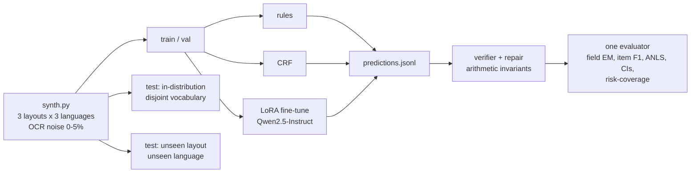
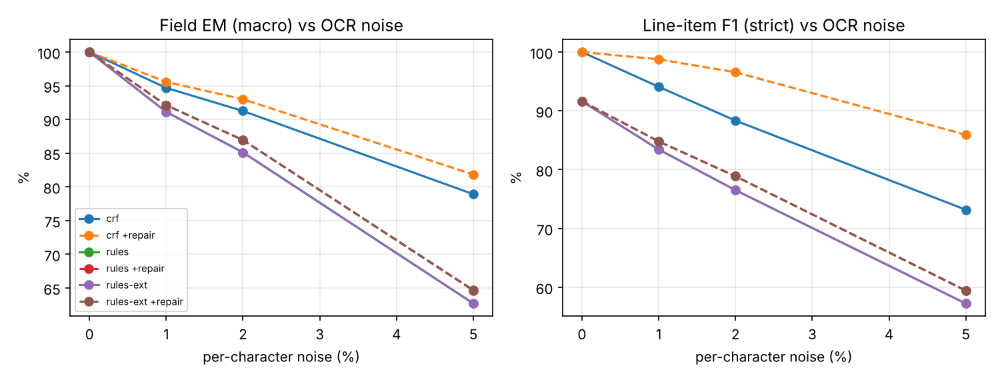
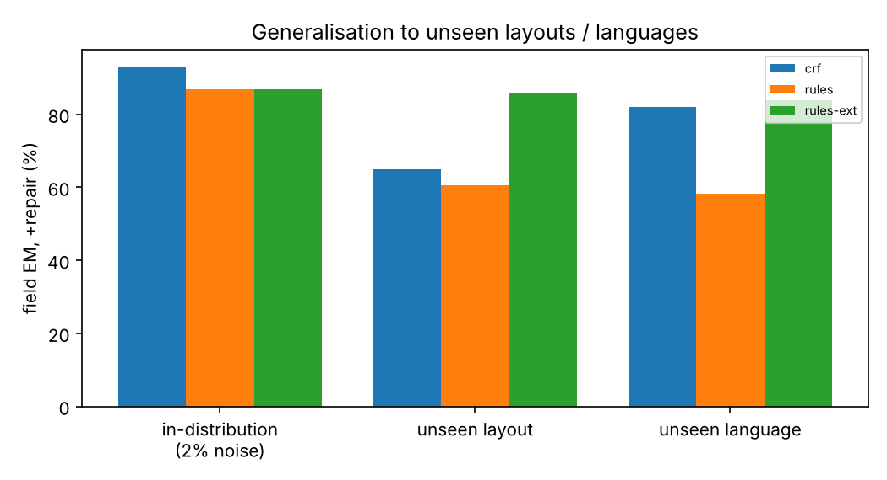
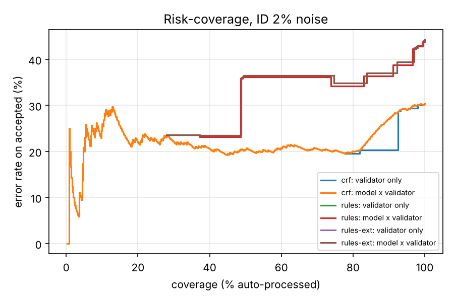

# docextract: benchmark-first LoRA fine-tuning for structured document extraction

Turn noisy OCR text of invoices / receipts into validated JSON, and **measure every design choice before trusting it**.

This repo compares three families of extractors under one evaluator, then adds a model-agnostic
**verifier/repair layer** that uses invoice arithmetic as free supervision:

| system | what it is | runs where |
|---|---|---|
| `rules` / `rules-ext` | hand-written regex baseline (EN/FR/DE), frozen v1 and manually extended v2 | CPU, 0.3 ms/doc |
| `crf` | token-level CRF tagger with calibrated marginals | CPU, ~2 ms/doc |
| `<model>-fewshot` / `<model>-lora-*` | Qwen2.5-Instruct base (few-shot) vs. the same model + LoRA adapter | free Colab/Kaggle T4 |
| `+repair` | arithmetic verifier + deterministic repair applied to *any* system's output | CPU |

## Status of the evidence (read this first)

* **Measured and committed (CPU, reproducible with `make all`):** synthetic benchmark, rules (v1 frozen + v2 extended), CRF,
  arithmetic repair layer, selective prediction.
* **Measured on real data:** public SROIE receipts (vendor, date, total; held-out n=126) via `make real`, including the
  synthetic-to-real transfer gap (see "Real-data check" below).
* **Implemented but *not yet run*:** LoRA training/inference (`docextract/llm/`). The authoring environment had no GPU and no
  Hugging Face access, so **there are no LoRA numbers in this repo and none are claimed**. `notebooks/colab_lora_benchmark.ipynb`
  runs the whole LLM benchmark on a free T4 (few-shot base model first, then LoRA), and `python -m docextract.report` /
  `python -m docextract.real_sroie --evaluate` merge the prediction files into the tables.
* Rules baseline: `rules` is frozen and was never tuned on held-out layouts. `rules-ext` was written *after* inspecting the
  held-out layout/language (and tuned on the SROIE *train* split), so its scores there are not held-out; they show what
  manual rule maintenance buys. See [docs/LIMITATIONS.md](docs/LIMITATIONS.md).

## Pipeline



## Quick start

```bash
pip install -e ".[dev]"
make all            # tests, data generation, CPU benchmark, report (about 3 min on 1 CPU)
make real           # downloads SROIE text/labels (a few MB) and runs the real-data check
```

GPU part (free Colab T4): open `notebooks/colab_lora_benchmark.ipynb`, or

```bash
pip install -e ".[llm]"
bash scripts/run_llm_benchmark.sh     # few-shot base -> LoRA fine-tune -> evaluate -> report
bash scripts/sweep_lora.sh            # optional rank x target-module sweep
```

## Design decisions that are benchmarked, not assumed

1. **Splits stress generalisation.** Test vendors/products are vocabulary-disjoint from train; extra test sets use a layout
   and a language never seen in training. Noise levels 0/1/2/5 % per character test robustness.
2. **Same evaluator for everything**: normalised field exact-match, ANLS, Hungarian-matched line-item F1 (strict and loose),
   hallucination rate on legitimately-null fields, JSON validity, bootstrap 95% CIs.
3. **Hyper-parameters chosen on validation only** (CRF regularisation grid and confidence variant; log in
   `results/baseline_selection.json`).
4. **Verifier/repair is evaluated as an ablation** (raw vs +repair) on every system, not assumed to help.
5. **Selective prediction**: does a confidence signal (model marginals, arithmetic consistency, or both) tell us which
   documents to send to a human? Measured with risk-coverage curves.
6. **LoRA choices are sweepable and logged**: rank, target modules, QLoRA flag, trainable-parameter count, wall time and
   peak GPU memory are written to `train_log.json` and reported next to accuracy.

## Real-data check: SROIE receipts

Real receipts print labels and values in separate OCR boxes, so same-line rules collapse; `crf-synth` shows how little a
model trained only on synthetic data transfers. Weak token labels for `crf-sroie` are derived by matching gold strings
back into the text (coverage on train: vendor 68%, date 98%, total 100%).

<!-- REAL:START -->
Fields available in SROIE: vendor (company), date, total. Exact match after the same normalisation as the synthetic benchmark; 95% bootstrap CI in brackets. `all3` = all three fields right.

| system | vendor EM | date EM | total EM | all3 | field EM (macro) |
|---|---|---|---|---|---|
| crf-sroie | 58.7 [50-67] | 93.7 [89-98] | 52.4 [44-61] | 35.7 [28-44] | 68.3 |
| crf-synth | 5.6 [2-10] | 18.3 [12-25] | 7.1 [3-11] | 0.0 [0-0] | 10.3 |
| rules-ext | 72.2 [64-79] | 97.6 [94-100] | 61.1 [52-70] | 40.5 [32-49] | 77.0 |
| rules | 50.0 [40-59] | 59.5 [51-68] | 4.8 [2-9] | 4.8 [2-9] | 38.1 |
<!-- REAL:END -->

## Synthetic benchmark

<!-- RESULTS:START -->


Every system is scored by the same code on the same files. 'repair' = arithmetic verifier/repair layer applied to that system's raw output. Doc EM = all 7 scalar fields and all line items exactly right (very strict; also see field EM). 95% bootstrap CI in brackets for doc EM.


## ID, 0% noise (n=500)

| system | post-proc | doc EM [95% CI] | field EM (macro) | item F1 (strict) | hallucination | JSON valid | ms/doc |
|---|---|---|---|---|---|---|---|
| crf | raw | 100.0 [100.0-100.0] | 100.0 | 100.0 | 0.0 | 100.0 | 2.3 |
| crf | +repair | 100.0 [100.0-100.0] | 100.0 | 100.0 | 0.0 | 100.0 | - |
| rules | raw | 62.8 [58.8-66.8] | 100.0 | 91.6 | 0.0 | 100.0 | 0.3 |
| rules | +repair | 62.8 [58.8-66.8] | 100.0 | 91.6 | 0.0 | 100.0 | - |
| rules-ext | raw | 62.8 [58.8-66.8] | 100.0 | 91.6 | 0.0 | 100.0 | 0.3 |
| rules-ext | +repair | 62.8 [58.8-66.8] | 100.0 | 91.6 | 0.0 | 100.0 | - |

## ID, 1% noise (n=500)

| system | post-proc | doc EM [95% CI] | field EM (macro) | item F1 (strict) | hallucination | JSON valid | ms/doc |
|---|---|---|---|---|---|---|---|
| crf | raw | 54.0 [49.8-58.8] | 94.7 | 94.1 | 0.0 | 100.0 | 2.2 |
| crf | +repair | 70.2 [66.6-74.2] | 95.6 | 98.8 | 0.0 | 100.0 | - |
| rules | raw | 25.4 [21.8-29.2] | 91.1 | 83.4 | 0.0 | 100.0 | 0.3 |
| rules | +repair | 31.6 [27.6-35.4] | 92.1 | 84.8 | 0.0 | 100.0 | - |
| rules-ext | raw | 25.4 [21.8-29.2] | 91.1 | 83.4 | 0.0 | 100.0 | 0.3 |
| rules-ext | +repair | 31.6 [27.6-35.4] | 92.1 | 84.8 | 0.0 | 100.0 | - |

## ID, 2% noise (n=500)

| system | post-proc | doc EM [95% CI] | field EM (macro) | item F1 (strict) | hallucination | JSON valid | ms/doc |
|---|---|---|---|---|---|---|---|
| crf | raw | 33.2 [29.2-37.4] | 91.3 | 88.3 | 0.0 | 100.0 | 2.3 |
| crf | +repair | 55.6 [51.2-59.8] | 93.0 | 96.6 | 0.0 | 100.0 | - |
| rules | raw | 9.6 [7.0-12.2] | 85.1 | 76.5 | 0.0 | 100.0 | 0.3 |
| rules | +repair | 17.0 [13.6-20.2] | 86.9 | 78.9 | 0.0 | 100.0 | - |
| rules-ext | raw | 9.6 [7.0-12.2] | 85.1 | 76.5 | 0.0 | 100.0 | 0.3 |
| rules-ext | +repair | 17.0 [13.6-20.2] | 86.9 | 78.9 | 0.0 | 100.0 | - |

## ID, 5% noise (n=500)

| system | post-proc | doc EM [95% CI] | field EM (macro) | item F1 (strict) | hallucination | JSON valid | ms/doc |
|---|---|---|---|---|---|---|---|
| crf | raw | 4.6 [2.8-6.4] | 78.9 | 73.2 | 0.0 | 100.0 | 2.7 |
| crf | +repair | 19.2 [16.0-23.0] | 81.8 | 85.9 | 0.0 | 100.0 | - |
| rules | raw | 0.4 [0.0-1.0] | 62.7 | 57.2 | 0.0 | 100.0 | 0.4 |
| rules | +repair | 1.4 [0.6-2.6] | 64.6 | 59.4 | 0.0 | 100.0 | - |
| rules-ext | raw | 0.4 [0.0-1.0] | 62.7 | 57.2 | 0.0 | 100.0 | 0.4 |
| rules-ext | +repair | 1.4 [0.6-2.6] | 64.7 | 59.5 | 0.0 | 100.0 | - |

## OOD layout, 2% (n=300)

| system | post-proc | doc EM [95% CI] | field EM (macro) | item F1 (strict) | hallucination | JSON valid | ms/doc |
|---|---|---|---|---|---|---|---|
| crf | raw | 0.0 [0.0-0.0] | 53.3 | 1.6 | 0.0 | 100.0 | 2.0 |
| crf | +repair | 0.0 [0.0-0.0] | 65.0 | 18.8 | 0.0 | 100.0 | - |
| rules | raw | 0.0 [0.0-0.0] | 60.5 | 0.0 | 0.0 | 100.0 | 0.3 |
| rules | +repair | 0.0 [0.0-0.0] | 60.5 | 0.0 | 0.0 | 100.0 | - |
| rules-ext | raw | 13.7 [10.0-17.3] | 83.7 | 79.3 | 0.0 | 100.0 | 0.3 |
| rules-ext | +repair | 21.7 [17.0-26.3] | 85.8 | 81.7 | 0.0 | 100.0 | - |

## OOD language (ES), 2% (n=300)

| system | post-proc | doc EM [95% CI] | field EM (macro) | item F1 (strict) | hallucination | JSON valid | ms/doc |
|---|---|---|---|---|---|---|---|
| crf | raw | 9.0 [6.0-12.7] | 80.9 | 88.9 | 0.0 | 100.0 | 2.6 |
| crf | +repair | 17.3 [13.0-21.7] | 82.0 | 95.6 | 0.0 | 100.0 | - |
| rules | raw | 0.0 [0.0-0.0] | 53.7 | 70.8 | 0.0 | 100.0 | 0.4 |
| rules | +repair | 0.0 [0.0-0.0] | 58.1 | 71.8 | 0.0 | 100.0 | - |
| rules-ext | raw | 5.3 [3.0-8.3] | 82.0 | 71.2 | 0.0 | 100.0 | 0.4 |
| rules-ext | +repair | 9.7 [6.7-13.0] | 83.8 | 73.0 | 0.0 | 100.0 | - |

## Per-field exact match, ID 2% noise (raw -> +repair)

| system | vendor | invoice_no | date | currency | subtotal | tax | total |
|---|---|---|---|---|---|---|---|
| crf | 81.4 -> 81.4 | 90.0 -> 90.0 | 90.8 -> 90.8 | 97.6 -> 97.6 | 93.4 -> 97.8 | 95.4 -> 97.0 | 90.2 -> 96.4 |
| rules | 80.8 -> 80.8 | 83.8 -> 83.8 | 86.8 -> 86.8 | 90.4 -> 90.4 | 82.8 -> 85.2 | 90.4 -> 93.2 | 80.8 -> 88.4 |
| rules-ext | 80.8 -> 80.8 | 83.8 -> 83.8 | 86.8 -> 86.8 | 90.4 -> 90.4 | 82.8 -> 85.2 | 90.4 -> 93.2 | 80.8 -> 88.4 |

## Selective prediction: can the system know when it is wrong?

Two correctness definitions: *critical* = vendor, date, currency and total all exact; *money* = subtotal, tax and total all exact (the part arithmetic can verify). Predictions are repaired first. AURC = area under risk-coverage curve (lower is better); 'cov@5%' = share of documents that can be auto-processed while keeping error <= 5%. Random ordering has AURC = overall error rate.

| test set | correct = | system | confidence signal | AURC | cov@5% risk | cov@1% risk | error rate (no abstain) |
|---|---|---|---|---|---|---|---|
| ID, 2% noise | critical | crf | model only | 0.3108 | 0.6% | 0.6% | 30.4% |
| ID, 2% noise | critical | crf | validator only | 0.2136 | 0.0% | 0.0% | 30.4% |
| ID, 2% noise | critical | crf | model x validator | 0.2206 | 0.6% | 0.6% | 30.4% |
| ID, 2% noise | money | crf | model only | 0.0628 | 65.0% | 0.6% | 5.8% |
| ID, 2% noise | money | crf | validator only | 0.0294 | 98.0% | 0.0% | 5.8% |
| ID, 2% noise | money | crf | model x validator | 0.0400 | 98.4% | 0.6% | 5.8% |
| ID, 2% noise | critical | rules | validator only | 0.3172 | 0.0% | 0.0% | 44.2% |
| ID, 2% noise | critical | rules | model x validator | 0.3172 | 0.0% | 0.0% | 44.2% |
| ID, 2% noise | money | rules | validator only | 0.1519 | 0.0% | 0.0% | 26.2% |
| ID, 2% noise | money | rules | model x validator | 0.1519 | 0.0% | 0.0% | 26.2% |
| ID, 2% noise | critical | rules-ext | validator only | 0.3199 | 0.0% | 0.0% | 44.2% |
| ID, 2% noise | critical | rules-ext | model x validator | 0.3199 | 0.0% | 0.0% | 44.2% |
| ID, 2% noise | money | rules-ext | validator only | 0.1503 | 0.0% | 0.0% | 26.2% |
| ID, 2% noise | money | rules-ext | model x validator | 0.1503 | 0.0% | 0.0% | 26.2% |
| ID, 5% noise | critical | crf | model only | 0.5775 | 0.0% | 0.0% | 64.0% |
| ID, 5% noise | critical | crf | validator only | 0.5035 | 0.0% | 0.0% | 64.0% |
| ID, 5% noise | critical | crf | model x validator | 0.4744 | 0.0% | 0.0% | 64.0% |
| ID, 5% noise | money | crf | model only | 0.1578 | 0.6% | 0.6% | 17.6% |
| ID, 5% noise | money | crf | validator only | 0.0512 | 73.2% | 0.0% | 17.6% |
| ID, 5% noise | money | crf | model x validator | 0.0401 | 78.6% | 29.2% | 17.6% |
| ID, 5% noise | critical | rules | validator only | 0.6865 | 0.0% | 0.0% | 79.6% |
| ID, 5% noise | critical | rules | model x validator | 0.6865 | 0.0% | 0.0% | 79.6% |
| ID, 5% noise | money | rules | validator only | 0.4488 | 0.0% | 0.0% | 62.4% |
| ID, 5% noise | money | rules | model x validator | 0.4488 | 0.0% | 0.0% | 62.4% |
| ID, 5% noise | critical | rules-ext | validator only | 0.6905 | 0.0% | 0.0% | 79.6% |
| ID, 5% noise | critical | rules-ext | model x validator | 0.6905 | 0.0% | 0.0% | 79.6% |
| ID, 5% noise | money | rules-ext | validator only | 0.4435 | 0.0% | 0.0% | 62.2% |
| ID, 5% noise | money | rules-ext | model x validator | 0.4435 | 0.0% | 0.0% | 62.2% |
<!-- RESULTS:END -->





## Repository layout

```
docextract/
  synth.py, noise.py        synthetic OCR documents with exact token + JSON gold labels
  normalize.py, schema.py   shared parsing / typing used identically by all systems
  baselines/rules.py, crf.py
  llm/prompt.py             prompt + robust JSON extraction (unit-tested, no torch needed)
  llm/train_lora.py         LoRA / QLoRA training loop (answer-only loss, fp16/bf16, logs cost)
  llm/infer.py              greedy decoding, adapter merge, sequence confidence
  validate.py               arithmetic checks + repair
  real_sroie.py             real-receipt loader (weak labels) + evaluation
  metrics.py, evaluate.py, report.py, bench.py
scripts/                    run_llm_benchmark.sh, sweep_lora.sh
notebooks/                  Colab T4 notebook
results/                    committed predictions, results.md, figures
tests/                      19 tests incl. a label-vs-gold data-quality gate
```

## Using your own work documents

`real_sroie.py` shows the pattern: produce `{id, text, gold}` JSONL (OCR text from Tesseract/PaddleOCR plus your annotations),
with token labels optional for the CRF. The LLM scripts only need `id` and `text` at inference. Evaluate on your data before
trusting any number here.

## License

MIT
